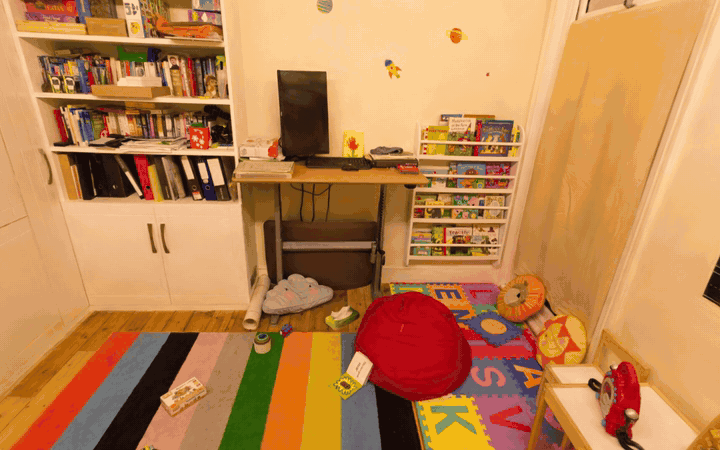

<div align="center">

<p><b>English</b> &nbsp;·&nbsp; <a href="./README.zh-CN.md">简体中文</a></p>

<a href="#quick-start"></a>

<h1>head-tracked-3d</h1>

<p><b>A room you can lean into.<br>A single webcam, no headset or controllers.</b></p>

<p>
<a href="#quick-start">Quick&nbsp;start</a> &nbsp;·&nbsp;
<a href="#how-it-works">How&nbsp;it&nbsp;works</a> &nbsp;·&nbsp;
<a href="#what-changed">What&nbsp;changed</a> &nbsp;·&nbsp;
<a href="NOTICE.md">Sources&nbsp;&amp;&nbsp;licence</a>
</p>

<p>


</p>

</div>

<br>

A **3D Gaussian Splatting** scene rendered in the browser, with its camera driven by **6DoF head pose from
an ordinary webcam**. A twenty-centimetre lateral head movement produces real parallax: the bookshelf
slides against the wall, the bean bag separates from the rug, and the desk emerges from the screen
plane. Nothing is pre-rendered, and the parallax is not produced by rotating the camera.

It is a rewrite of [`rossning92/head-tracked-3d`](https://github.com/rossning92/head-tracked-3d)
(2021). That project placed a Miku model on a virtual screen and moved the camera to imitate a window;
this version places the viewpoint inside a photographed room and removes the virtual screen.

## The scene

The scene is **Deep Blending `playroom`**, trained with the reference 3DGS implementation for 30 000
iterations and converted to the 32-byte `.splat` layout: **1,916,379 gaussians, 58.5 MB**, loaded from
`public/` at runtime.

The standing point was not chosen arbitrarily. It was selected by rendering the point cloud offline
from a grid of candidate anchors, then keeping the one that frames the entire room while remaining
inside the region the capture actually covers. It sits about 1.7 room-units from the back wall, so
lateral head movement does not push the camera through it.

### Swapping the scene

Everything that describes *this* capture is contained in a single object in
[`src/config.ts`](src/config.ts):

```ts
export const SCENE = {
  url: assetUrl("splats/playroom.splat"), // resolved against BASE_URL, so sub-path hosting works
  anchor: new THREE.Vector3(0.3, 0.23, -2.8), // where you stand, in the dataset's own coordinates
  pitch: 180, // the dataset's "up" is inverted (common for COLMAP-based captures)
  yaw: 0,     // which way you face
  scale: 0.5, // does not change the framing — it sets how much parallax a given head move buys
};
```

Three items cannot be derived from the code and must be re-calibrated for each dataset: the **up**
direction, the **standing point**, and the **world scale**. `tools/ply2splat.cjs` converts a 3DGS
`.ply` to `.splat` (with optional importance-based decimation when a splat budget is given). Render a
set of comparison images first, then determine the anchor from them.

One point is easy to misread: in `room-7k.splat`, the asset this demo started with, `7k` refers to
**7 000 training iterations**, not 7 000 points. The file contains 1.13 M gaussians yet remains blurry
throughout, because the model is undertrained. Sharpness depends on the training iteration count, not
on the number of splats.

## Quick start

```sh
npm install
npm start          # http://127.0.0.1:8000
```

The page requests camera access. Grant it, sit about 60 cm from the screen, and move your head slowly.

| Situation | What to do |
| --- | --- |
| No camera, or permission denied | append `?demo` to substitute a synthetic head movement for the webcam |
| The view drifts over time | press **Recenter** in the panel to record the current pose as straight ahead |
| The interface language is wrong | append `?lang=zh` or `?lang=en` |
| The panel should not appear on screen | press `H` |

```sh
npm run build      # static site into docs/
npm run typecheck  # tsc --noEmit
```

`docs/` is a build artefact and is not committed; CI generates it during deployment.

### Deploying to GitHub Pages

[`.github/workflows/deploy.yml`](.github/workflows/deploy.yml) is already configured: a push to `main`
or `master` (or a manual run from the Actions tab) runs `npm ci`, the type check and the build, then
publishes `docs/` to Pages.

Before the first deployment, set **Source** to **GitHub Actions** under
**Settings → Pages → Build and deployment**. The workflow attempts to enable Pages automatically; if
repository policy blocks it, set it once by hand. The site is then served at
`https://<user>.github.io/<repo>/`.

Every path in the build is relative (`base: "./"`, with the scene URL derived from `BASE_URL`), so the
repository name does not affect deployment and a custom domain needs no configuration change.

## Controls

No setting needs adjustment before the demo runs; all options only affect the viewing result.

The panel is bilingual and takes its language from the browser: a preferred language starting with
`zh` selects Chinese, anything else selects English, so English is the default. Append `?lang=zh` or
`?lang=en` to fix the language.

| Control | Default | What it does |
| --- | --- | --- |
| **Head tracking** | on | master switch. When off, the camera returns to the neutral position |
| **Demo (no camera)** | off | uses a synthetic head movement; no camera required (same as `?demo`) |
| **Parallax** | 1.0 | maps head translation to camera translation. Increase if the parallax appears weak |
| **Follow head turn** | 1.0 | 0 = head rotation does not change the view; 1 = 1:1 with the real world |
| **Rotation limit** | 30° | clamp on yaw. Only the front direction of this capture is reliable; see *Limits* |
| **Dolly in / out** | 0.0 | moves the standing point along the view axis, in room units; negative moves closer to the desk |
| **Face landmarks** | off | overlays all 478 landmarks on the camera preview |

## How it works

```
webcam ──► FaceLandmarker ──► pose ────► stabiliser ──► One Euro ──► low-pass ──► camera
            478 landmarks      iris xy     hold / edge     per axis     85 ms       position
            4×4 transform      dist        hysteresis      adaptive               + rotation
                               yaw, pitch
```

**Distance comes from the transform, not from the iris.** MediaPipe returns a rigid 4×4 matrix whose
translation column is in centimetres. Eye-to-screen distance is that `tz` rescaled against a 60 cm
reference: `dist = 1.6 × faceCm / 60`. Estimating it from iris pixel spacing, as the 2021 version did,
becomes unreliable as soon as the head turns.

**The camera uses a plain perspective projection.** The original used off-axis projection
(`setViewOffset`) to pin the image to the screen plane, which is correct when the content is itself a
screen. Inside a real room it inverts the depth relationship: objects near the screen plane stop
moving, while distant objects move more. With the desk at 1.65 m and the plane at 1.6 m, the desk
remained completely static, which is the underlying cause of the "view feels slow" problem. The fix is
to remove the offset, not to raise the gain.

Displacement on screen, in screen half-widths, for a 0.2 lateral head offset at `dist = 1.6`:

| Object | Distance | Pinned to the screen | Camera translates (now) |
| --- | --- | --- | --- |
| rug | 0.8 | 0.20 | 0.40 |
| desk | 1.65 | **≈ 0.00** | **0.19** |
| bookshelf | 2.5 | −0.07 | 0.13 |

**Rotation has a zero point, calibrated once.** Yaw and pitch from the matrix are absolute, so they
carry the user's sitting posture. The zero is the mean of the first twenty valid poses; it does not
change afterwards, and **Recenter** resets it. An earlier version tracked the zero continuously, which
silently cancelled the user's own head movement; the slider appeared to have no effect because the
reference point had already followed the head.

**Tracking loss is handled by a state machine, not a single `if`.**
[`src/pose-stabilizer.ts`](src/pose-stabilizer.ts) holds the last valid pose for 10 frames (~330 ms).
When the face reaches the edge of the frame, the landmarks are already distorted, so the state machine
freezes indefinitely: holding still is less disruptive than recentring. Only when the face actually
leaves the frame does it report `valid: false`, after which a 0.35 s time constant moves the camera
back to the neutral position instead of snapping it there.

## What changed

| | 2021 original | This version |
| --- | --- | --- |
| Face tracking | clmtrackr, 2D landmarks | MediaPipe Face Landmarker, 478 landmarks + 4×4 transform |
| Depth | iris pixel spacing (IPD) | rigid-transform translation, rescaled against 60 cm |
| Smoothing | fixed-α EMA | One Euro per axis, with a filtered derivative term |
| Projection | off-axis, pinned to the screen plane | plain perspective camera |
| Rotation | none | 6DoF yaw/pitch, clamped, with a one-shot zero |
| Tracking loss | `valid = false` → snap to centre | hold → freeze at edge → slow drift home |
| Scene | Miku MMD on a checkerboard | 3DGS photoreal room |
| Build | webpack, JavaScript | Vite 5, TypeScript 5 |
| Frame loop | `requestAnimationFrame` | `renderer.setAnimationLoop` |

## Tech stack

| Layer | Choice |
| --- | --- |
| Renderer | three.js 0.169, WebGL 2 |
| Splats | `@mkkellogg/gaussian-splats-3d` 0.4.7, `DropInViewer`, 32-byte `.splat` |
| Face tracking | MediaPipe Tasks Vision 0.10.18, `FaceLandmarker`, GPU delegate, ~30 fps |
| Filtering | One Euro (own implementation) + a render-side exponential low-pass |
| Panel | Tweakpane 3 |
| Build | Vite 5, TypeScript 5. No test framework; the two pure modules are verified with temporary Node scripts |

## Limits

- **The capture covers the front direction only.** Behind the standing point is a stairwell with very
  little observation coverage; the model fills it with large, low-opacity gaussians that appear as fog.
  The region becomes visible when turning beyond roughly 30°. Filtering those gaussians out does not
  help: it leaves holes in the ceiling.
- **The parallax range is deliberately small.** About 20 cm of travel stays within the
  best-reconstructed region. A larger range looks more dramatic but degrades visibly.
- **Single scene, single person, discrete GPU.** No multi-face tracking, no runtime scene swapping, no
  mobile fallback: 1.9 M gaussians require a dedicated GPU.

## Project layout

```
src/
  index.ts           boot, panel, tracking loop, camera
  config.ts          scene and calibration constants; the only file to edit when swapping material
  scene.ts           3DGS loading and the anchor-pinned placement
  head-tracker.ts    webcam, FaceLandmarker, pose extraction
  pose-stabilizer.ts hold / edge hysteresis / jump rejection (pure, testable)
  pose-math.ts       matrix → yaw/pitch, normalised across layout conventions
  math-helper.ts     One Euro filter
media/preview.gif    the preview above, recorded from ?demo
tools/ply2splat.cjs  .ply → .splat converter used to produce the scene
public/splats/       the 58.5 MB scene, committed so that a clone runs out of the box
```

## Licence

**The code is MIT-licensed**, inherited from the original project. **The scene is research material**:
a Deep Blending capture rendered with the 3DGS reference implementation, under non-commercial terms.
For commercial use, substitute your own capture; `src/config.ts` and this file are the only places that
need to change. [`NOTICE.md`](NOTICE.md) contains the full provenance and citation requirements.
