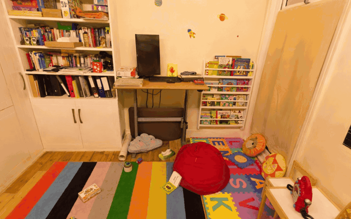

<div align="center">

<p><a href="./README.md">English</a> &nbsp;·&nbsp; <b>简体中文</b></p>

<a href="#快速开始"></a>

<h1>head-tracked-3d</h1>

<p><b>一个可以探身观察的房间。<br>只需一个普通摄像头，无需头显或手柄。</b></p>

<p>
<a href="#快速开始">快速开始</a> &nbsp;·&nbsp;
<a href="#工作原理">工作原理</a> &nbsp;·&nbsp;
<a href="#与原版的差异">与原版的差异</a> &nbsp;·&nbsp;
<a href="NOTICE.md">素材与许可</a>
</p>

<p>


</p>

</div>

<br>

这是一个在浏览器中渲染的 **3D 高斯泼溅（3DGS）** 场景，相机位置由**普通网络摄像头**采集的 **6DoF 头部
姿态**驱动。头部横移二十厘米时，书架相对墙面滑动，懒人沙发与地毯产生错位，书桌从屏幕平面中分离出来，
形成真实的视差。场景没有预渲染，视差也不是通过旋转相机伪造的。

本项目是 [`rossning92/head-tracked-3d`](https://github.com/rossning92/head-tracked-3d)（2021）的重写版。
原版将初音模型贴在一块虚拟屏幕上，通过移动相机来模拟一扇窗；本版则将视点直接放入一间实拍房间，不再需要
这扇虚拟的窗。

## 场景

场景取自 **Deep Blending 的 `playroom`**，使用 3DGS 参考实现训练至 30000 次迭代，以 **SPZ v2** 格式提供：
**1,916,379 个高斯，30.1 MB**，运行时从 `public/` 同源加载。同一份数据若存成 32 字节的 `.splat` 需要
61.3 MB，压缩容器把下载量减半，且一个高斯都没有丢：位置改为 24 位定点，尺度取对数后量化成 8 位，
四元数只存三个分量。

站位不是随意选定的：先离线将点云渲染成一组候选机位的网格图，再从中挑出既能容纳整间屋子、又落在采集
实际覆盖区域内的一处。该位置距后墙约 1.7 个房间单位，左右移动时头部不会穿入墙体。

### 更换素材

与本次采集相关的全部参数集中在 [`src/config.ts`](src/config.ts) 的一个对象中：

```ts
export const SCENE = {
  url: assetUrl("splats/playroom.spz"), // 由 BASE_URL 解析，部署到子路径也能加载
  bytes: 30_510_821, // 只用于算下载百分比
  anchor: new THREE.Vector3(0.3, 0.23, -2.8), // 你站在房间的哪一点（数据集自己的坐标）
  pitch: 180, // 数据集的"上"是反的（COLMAP 系采集常见）
  yaw: 0,     // 面朝哪边
  scale: 0.5, // 不影响构图——它决定"同样的头部动作能换到多少视差"
};
```

有三项无法从代码推断，必须针对每个数据集重新标定：**上方向**、**站位**、**世界尺度**。
格式转换由 `tools/` 下的两个脚本完成：`ply2splat.cjs` 把 3DGS 的 `.ply` 转成 `.splat`（可指定点数
上限，按重要性抽稀），`splat2spz.cjs` 再打包成渲染器读取的 SPZ v2 容器。建议先用它们渲染若干对照图，
再据此确定 anchor。

有一处容易误读：本项目早期使用的 `room-7k.splat` 中，`7k` 指训练迭代 7000 步，而非 7000 个点。该文件
包含 113 万个高斯，画面却整体模糊，原因是训练不充分。清晰度取决于训练迭代次数，与点数无关。

## 快速开始

```sh
npm install
npm start          # http://127.0.0.1:8000
```

页面会请求摄像头权限。允许后，请坐在距屏幕约 60 厘米处，并缓慢移动头部。

| 情况 | 处理方式 |
| --- | --- |
| 没有摄像头，或拒绝了权限 | 在地址后加 `?demo`，以合成的头部动作代替摄像头 |
| 视点持续偏移 | 点击面板中的 **重新居中**，将当前姿态记为正前方 |
| 界面语言不正确 | 在地址后加 `?lang=zh` 或 `?lang=en` |
| 不希望面板出现在画面中 | 按 `H` |

```sh
npm run build      # 静态站点输出到 docs/
npm run typecheck  # tsc --noEmit
```

`docs/` 为构建产物，不纳入版本库，由 CI 在部署时生成。

### 部署到 GitHub Pages

[`.github/workflows/deploy.yml`](.github/workflows/deploy.yml) 已经配置好：向 `main` 或 `master`
推送（也可以在 Actions 页手动触发）会依次执行 `npm ci`、类型检查与构建，然后把 `docs/` 发布到 Pages。

**第一次要先手动启用**：在仓库的 **Settings → Pages → Build and deployment** 里把 **Source** 设为
**GitHub Actions**。workflow 中的 `enablement: true` 会尝试代劳，但新建仓库上这一步通常会被拦下，
报 `Resource not accessible by integration`，因为创建 Pages 站点所需的权限不在 `GITHUB_TOKEN` 的能力范围内。
这一步失败属于预期，设好 Source 后重跑即可。站点地址为 `https://<用户名>.github.io/<仓库名>/`。

构建产物全部使用相对路径（`base: "./"`，场景地址由 `BASE_URL` 拼出），因此仓库名不影响部署，
之后改用自定义域名也不需要修改配置。

## 控制面板

面板中的选项只影响观看效果，保持默认即可正常使用。

面板为中英双语，语言由浏览器首选语言决定：以 `zh` 开头显示中文，其余一律显示英文，因此默认语言为英文。
如需固定语言，可在地址后加 `?lang=zh` 或 `?lang=en`。

| 选项 | 默认 | 说明 |
| --- | --- | --- |
| **头部追踪** | 开 | 总开关。关闭后相机回到中性位置 |
| **演示模式** | 关 | 使用合成的头部动作，不需要摄像头（等同 `?demo`） |
| **视差强度** | 1.0 | 头部平移量映射为相机位移。若视差不足可适当调高 |
| **转头跟随** | 1.0 | 0 表示转头不改变视角；1 表示与真实世界 1:1 |
| **转向上限°** | 30 | 左右转动的钳位。本次采集仅正前方可靠，见「限制」 |
| **视点进退** | 0.0 | 沿视线前后调整站位，单位为房间单位；负值表示靠近书桌 |
| **显示面部关键点** | 关 | 在摄像头预览上叠加全部 478 个关键点 |

## 工作原理

```
摄像头 ──► FaceLandmarker ──► 位姿 ──────► 稳定器 ──────► One Euro ──► 低通 ──► 相机
            478 个关键点      虹膜归一化     丢帧保持/     逐轴自适应    85 ms    位置与朝向
            4×4 变换矩阵      距离/偏航/俯仰  边缘迟滞
```

**距离来自变换矩阵，而非虹膜位置。** MediaPipe 返回的 4×4 矩阵是刚性变换，平移列的单位为厘米。眼睛到
屏幕的距离由该矩阵的 `tz` 按 60 厘米基准折算：`dist = 1.6 × faceCm / 60`。若改用原版基于虹膜像素间距
的估算方式，头部一旦转动就会严重失准。

**相机采用普通透视投影。** 原版使用离轴投影（`setViewOffset`）将画面固定在屏幕平面上。当内容本身就是
一块屏幕时，这一做法是正确的；但放入真实房间后，深度关系会反转：靠近屏幕平面的物体几乎不移动，距离越远
反而移动越多。场景中的书桌距相机 1.65 m，屏幕平面位于 1.6 m，因此它在原版中完全静止，这也是"画面移动
偏慢"的根本原因。修复方式是移除该偏移，而不是提高增益。

横向头部偏移 0.2、`dist = 1.6` 时，各物体在屏幕上的位移（单位为屏幕半宽）：

| 物体 | 距离 | 固定于屏幕平面 | 相机平移（本版） |
| --- | --- | --- | --- |
| 地毯 | 0.8 | 0.20 | 0.40 |
| 书桌 | 1.65 | **≈ 0.00** | **0.19** |
| 书架 | 2.5 | −0.07 | 0.13 |

**旋转存在零点，且只标定一次。** 矩阵给出的偏航与俯仰是**绝对朝向**，包含用户的坐姿。零点取启动后前
20 帧有效位姿的平均值；此后不再自行变化，需要重设时点击 **重新居中**。早期版本让零点持续跟踪当前姿态，
用户自身的转动因此被抵消；滑杆看似失效，实际是参照点已经随头部移动。

**追踪丢失由状态机处理，而不是一句 `if`。** [`src/pose-stabilizer.ts`](src/pose-stabilizer.ts) 会将
最后一次有效位姿保持 10 帧（约 330 ms）。当人脸到达画面边缘时，landmark 已经变形，此时状态机会无限期
冻结：相比直接回中，保持不动更不容易造成困惑。只有在人脸真正离开画面后才报告 `valid: false`，再由渲染端
以 0.35 s 的时间常数将相机缓慢移回中位，而不是瞬间归位。

**场景先下载，再解析。** [`src/splat-source.ts`](src/splat-source.ts) 自己把文件取下来，再交给渲染器一个
`blob:` 地址。库内置的加载是一条不带重试的 fetch，任何失败——连接中断、404、解码错误——都只说一句
"Could not load file"。先落到内存，网络就成了唯一可能出错的一环，面板也才报得出真实百分比。
这里刻意不做 Range 断点续传：GitHub Pages 对该文件是实时 gzip 传输，`Range` 命中的是压缩流上的偏移
（在 1 MB 处取一段回来比对，字节与原文件对不上），续传拼起来就是坏数据。失败时整份重下，最多两次。

## 与原版的差异

| | 2021 原版 | 本版 |
| --- | --- | --- |
| 人脸追踪 | clmtrackr，2D 关键点 | MediaPipe Face Landmarker，478 点 + 4×4 变换 |
| 深度 | 虹膜像素间距（IPD） | 刚性变换的平移量，按 60 cm 折算 |
| 平滑 | 固定 α 的 EMA | 逐轴 One Euro，导数项经过滤波 |
| 投影 | 离轴，钉在屏幕平面 | 普通透视相机 |
| 旋转 | 无 | 6DoF 偏航/俯仰，带钳位与一次性零点 |
| 追踪丢失 | `valid = false` → 瞬间归中 | 保持 → 贴边冻结 → 缓慢漂回 |
| 场景 | 棋盘格上的初音 MMD | 3DGS 照片级房间 |
| 构建 | webpack + JavaScript | Vite 5 + TypeScript 5 |
| 帧循环 | `requestAnimationFrame` | `renderer.setAnimationLoop` |

## 技术栈

| 层 | 选择 |
| --- | --- |
| 渲染 | three.js 0.169，WebGL 2 |
| 高斯 | `@mkkellogg/gaussian-splats-3d` 0.4.7，`DropInViewer`，SPZ v2（30.1 MB） |
| 人脸 | MediaPipe Tasks Vision 0.10.18，`FaceLandmarker`，GPU delegate，约 30 fps |
| 滤波 | One Euro（自己实现）+ 渲染侧一阶低通 |
| 面板 | Tweakpane 3 |
| 构建 | Vite 5、TypeScript 5。未引入测试框架，两个纯逻辑模块通过临时 Node 脚本验证 |

## 限制

- **本次采集仅覆盖正前方。** 站位背后是楼梯间，观测极少，模型只能用一层大而淡的高斯填充，视觉上呈现为
  雾状。转动约 30° 后即可看到该区域。将这些高斯滤除也无济于事，天花板会出现空洞。
- **视差幅度小是有意为之。** 约 20 厘米的移动范围恰好位于重建质量最好的区域内。更大的移动幅度观感更强，
  但画面质量会明显下降。
- **单场景、单人、独立显卡。** 不支持多人追踪，不支持运行时更换场景，也没有移动端降级方案：190 万个
  高斯需要真正的 GPU。

## 项目结构

```
src/
  index.ts           启动、面板、追踪循环、相机
  config.ts          场景与标定常量；更换素材只需修改此文件
  scene.ts           3DGS 加载与"锚点钉住"的摆放
  head-tracker.ts    摄像头、FaceLandmarker、位姿解算
  pose-stabilizer.ts 丢帧保持 / 边缘迟滞 / 跳变拒绝（纯逻辑，可测）
  pose-math.ts       矩阵 → 偏航/俯仰，抹平下标与朝向约定
  math-helper.ts     One Euro 滤波器
media/preview.gif    上方预览动图，由 ?demo 录制
tools/ply2splat.cjs  .ply → .splat 转换器，用于生成本场景
tools/splat2spz.cjs  .splat → SPZ v2 打包器，体积减半且不丢高斯
public/splats/       30.1 MB 场景数据，随仓库提交，否则克隆后无法运行
```

## 许可

**代码采用 MIT 许可**，继承自原项目。**场景属于研究素材**：来自 Deep Blending 的采集，由 3DGS 参考
实现渲染，适用非商用条款。如需商用，请替换为自有采集；需要修改的只有 `src/config.ts` 和本文件。完整的
来源说明与引用要求见 [`NOTICE.md`](NOTICE.md)。
